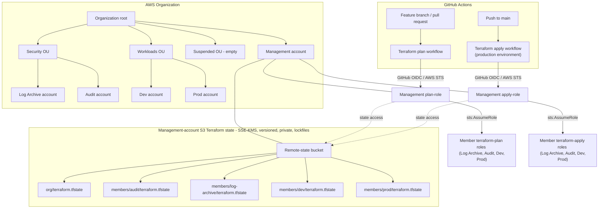

# Secure AWS Landing Zone
**Multi-account AWS foundations built with Terraform, GitHub Actions OIDC, and explicit security boundaries.**

This project builds and operates the foundations of an AWS Organization as code. It separates security and workload accounts, uses short-lived CI credentials instead of stored AWS access keys, and distinguishes infrastructure review (`plan`) from deployment (`apply`). The implementation is delivered incrementally, with architecture decisions and verification evidence linked alongside the code.

**Phase 2.0: Foundations: ✅ complete, 2026-11-09 (latest foundations merge: )**.

**Design:**

* 📄 [ADR 0001 - delivery and identity](./docs/adr/0001-delivery-and-identity-architecture.md)
* 📄 [ADR 0002 - organization design](./docs/adr/0002-organization-design.md)

**Verification:**

* 📄 [Phase 2.0 evidence checklist](./docs/evidence/phase-2.0/)

The diagram shows deployed organization structure and implemented CI/state paths, not the security services planned for later phases. The `Log Archive` and `Audit` accounts are separate account boundaries; centralized log ingestion and security-service deployment are not implied by their names.

## Phase 2.0 - What was built

* **Bootstrap** - Provisioned the management-account, KMS-encrypted and versioned S3 state backend, state safeguards, GitHub OIDC provider, separate CI plan/apply roles. **[Source →](./bootstrap/main.tf)**
* **Organization** - Created three OUs (Security, Workloads, Suspended) and four member accounts (Log Archive, Audit, Dev, and Prod), with a recorded no-change Terraform plan. **[Verified PR →](https://github.com/mananqayas/secure-aws-landing-zone/pull/49)**
* **Baseline module** - Applied a reusable member-account baseline with `terraform-plan` / `terraform-deploy`, IAM permission boundaries, account-level S3 public-access blocking, and default EBS encryption. **[Source →](./modules/account-baseline/main.tf)**
* **Graduation** - Transitioned member-account Terraform roots off initial `OrganizationAccounAccessRole` bootstrapping to the routine cross-account role path ( `bootstrapping = false` ). **[Configuration](./envs/dev/terraform.tfvars)**
* **Retirement** - Verified that routine management CI plan/apply roles cannot assume a member account's `OrganizationAccountAccessRole`; this is retirement of the CI access path, **not** deletion of the AWS role. **[Negative-test run](https://github.com/mananqayas/secure-aws-landing-zone/actions/runs/42539792312)**

**Operational evidence:** **[PR #49](https://github.com/mananqayas/secure-aws-landing-zone/pull/49)** records successful organization and member-account Terraform-checks with no pending changes; the negative-test workflow checks the restricted administrator-role access path.

## What to look

| Area | Source |
| ------ | ---- |
| Boostrap, state security, OIDC identities | **[`boostrap/main.tf`](./bootstrap/main.tf)** |
| OU and account definitions | **[`envs/organization/main.tf`](./envs/organization/main.tf)** |
| Reusable member-account controls | **[`modules/account-baseline/main.tf`](./modules/account-baseline/main.tf)** |
| CI plan and deploy | **[`terraform-plan.yml`](.github/workflows/terraform-plan.yml) /  [`terraform-apply.yml`](.github/workflows/terraform-apply.yml)** |
| Architecture decisions and test evidence | **[`ADR-0001`](./docs/adr/0001-delivery-and-identity-architecture.md) / [`ADR-0002`](./docs/adr/0002-organization-design.md) / [`Phase 2.0 checklist`](./docs/evidence/phase-2.0/README.md)**  |

