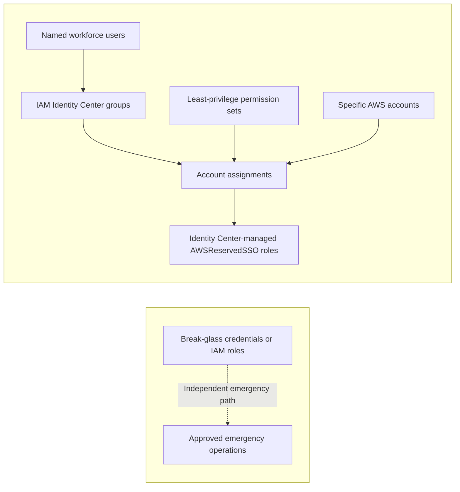

# ADR-0003: Group-Based Workforce Access with IAM Identity Center and Independent Break-Glass Acccess

Date: 2026-11-13

Status: Accepted

## Context
The landing zone separates responsibilities across the management, log archive, audit, development, and production AWS accounts. Engineers and administrators need different levels of access to these accounts. Managing direct user-to-account grants or long-lived IAM credentials independently in each account would increase administrative overhead, make offboarding harder, and raise the risk of inconsistent or excessive privilege.

The access model must provide:

* A central place to manage named workforce identities and their membership in functional groups.
* Role and environment-specific authorization, with least privilege administration.
* A clear distinction between routine developer activity and privileged administration.
* Auditable, reviewable account assignments managed as infrastructure as code.
* A recovery path when IAM Identity Center or its authentication dependencies are unavailable.

## Decision
**Use an AWS Organizations instance of IAM Identity Center as the standard entry point for human access. Grant access exclusively through group-to-permission-set-to-account assignments, not direct assignments to individual workforce users. Maintain emergency access separately from IAM Identity Center.**

1. **Identity and group membership**
* Every workforce member has an individually attributable identity in the configured IAM Identity Center identity source; shared routine accounts are not permitted.
* Users join one or more groups reflecting their responsibilities and approved need for access (for example, `developers`, `platform-admins`, and `security auditors`).
* Group membership is the mechanism for granting, changing, and removing routine access. It requires an approved change and is reviewed periodically.
* No direct user-to-AWS-account assignments with be created through IAM Identity Center. Group membership does not imply access to every account.
* Workforce authentication must use MFA, enforced by IAM Identity Center when it manages authentication or by the external identity provider when one is configured.

2. **Permission sets and account assignments**
* Define reusable IAM Identity Center **permission sets** for functional duties, such as restricted developer operations, read-only investigation, and administrative maintenance.
* Use narrowly scoped, documented policies, avoid broad administrative permissions for daily activities. Permission sets may be reused across accounts where the intended privilege level is identical.
* Create account assignments using the explicit **group + permission set + AWS account** tuple. The same group may receive different permission sets in different accounts.
* Separate routine and privilege access. Administrators use a restricted permission set for ordinary work and explicitly select a privileged permission set only when necessary.
* Restrict access to the AWS Organizations management account to a small, approved administrative group. Production write access requires separate approval and tighter controls than development access.
* Use appropriately short session durations, especially for privileged permission sets. IAM Identity Center provisions and manages the corresponding `AWSReservedSSO_*` IAM roles in target accounts; these roles must not be edited manually.

**Access matrix**

| Group | Account(s) | Permission set | Purpose |
| -------- | ----------- | ---------- | ------- |
| `Developers` | Dev | `Developers` | Routine application development |
| `PlatformAdmins` | Management, Log Archive, Audit, Dev and Prod | `PlatformAdmins` | Approved maintenance and operations |
| `ReadOnlyAuditors` | Management, Log Archive, Audit, Dev and Prod | `ReadOnlyAuditors` | Security review and investigation |

The matrix illustrates intended separation of dutites. No default production write access is granted to the `Developers` group.

3. **Emergency access outside IAM Identity Center**
* Maintain a documented **break-glass recovery path independent of IAM Identity Center**, reserved for IAM Identity Center unavailability, widespread administrative lockout, or essential root-only recovery tasks. It is never a convenience alternative to standard group-based access.
* Protect the management account root identity with a strong unique credential and phishing-resistant MFA (passkey/security key where supported); prohibit root access keys and ordinary administrative use.
* Store recovery material securely outside the ordinary access path; limit custodians, require explicit incident authorization where practicable, and log and alert on emergency activity.
* The management account root identity **does not automatically grant access to every member account**. If emergency operations require member-account access, provision and test a separate IAM-based emergency role/assume-role path independent of IAM Identity Center, documented in the break-glass runbook. Root-only tasks and member-account emergency operations are distinct cases.
* After any break-glass use, revoke temporary access, rotate the root password and any other recovery credentials required by the runbook, review the session in CloudTrail and other relevant logs, document the incident, and confirm the standard access path is restored. Replace an MFA factor if compromised or custoday cannot be assured; password rotation does not invalidate existing AWS sessions.
* Do not commit root email addresses, credential material, MFA identifiers, recovery codes, or emergency role secrets to the public repository.

4. **Infrastructure-as-code governance**
* Manage Identity Center groups, permission sets, memberships, and account assignments through Terraform where supported by the selected identity source, with peer-reviewed Git changes.
* Require approval for new privileged permission sets, increases in policy scope, membership changes to privileged groups, and production/management-account assignments.
* Validate proposed assignments against an approved access matrix; detect unauthorized console drift and reconcile it through the reviewed configuration.
* Record sign-ins, role assumptions, and privileged actions using organization-wide audit logging and alerting. Review access periodically and remove grants promptly when no longer needed.
* IAM Identity Center access is for **human workforce access.** Workload identities and GitHub Actions automation use dedicated IAM roles and short-lived credentials (for example, OIDC federation), outside this ADR's assignment model.

## Architecture

IAM Identity Center evaluates the configured group, permission set, and account assignment; a successful assignment provisions the service-managed IAM role in the target AWS account.

## Alternative considered

| Alternative | Reason not selected |
| ----------- | ------------------- |
| Assign permission sets directly to each user | Creates user-specific exceptions, complicates access reviews and offboarding, and increases drift risk. |
| Create IAM users and access keys in each AWS account | Introduces long-lived credentials and decentralized identity lifecyle management |
| Give developers permanent administrative access | Violates least privilege and makes accidental or maliciouschanges harder to contain. |
| Depend exclusively on IAM Identity Center, including emergency access | Leaves no independent recovery routeduring an Identity Cetner or broad lockout. |

## Consequences
**Positive:** Standardized authorization across accounts; easier onboarding, offboarding, and audits; reduced standing privilege; consistent role naming and policy reuse; human access separated from workload automation; more resilient administrative recovery.

**Trade-offs:** Group and permission-set design must be maintained carefully; membership in multiple groups can accumulate privileges; Terraform and Identity Center configuration changes can affect multiple accounts; service disruptions still affect normal sign-in; independent emergency access requires secure custody, monitoring, testing, and documented procedures.

## Verification and review
* Confirm that **every** normal AWS account assignment references a group rather than an individual user.
* Test representative developer, administrator, and auditor identities in each relevant account for **allowed and denied** actions.
* Verify MFA is enforced and privileged sessions are appropriately limited.
* Remove a test user from a group and confirm access is revoked as expected, accounting for existing session duration.
* Confirm management, log archive, and production access match the approved access matrix.
* Exercise the break-glass runbook in a controlled test without relying on IAM Identity Center, including any required member-account access path; verify alerts and audit evidence.
* Revisit this ADR if the identity source, AWS account structure, privileged-access requirements, or emergency-access design changes.

## References
* [AWS - Assign user or group access to AWS accounts](https://docs.aws.amazon.com/singlesignon/latest/userguide/assignusers.html)
* [AWS - Managed AWS accounts with permission sets](https://docs.aws.amazon.com/singlesignon/latest/userguide/permissionsetsconcept.html)
* [AWS - IAM Identity Center emergency-access planning](https://docs.aws.amazon.com/singlesignon/latest/userguide/emergency-access-planning.html)
* [AWS - Root user best practices](https://docs.aws.amazon.com/IAM/latest/UserGuide/root-user-best-practices.html)
* [AWS - Centralize root access for member accounts](https://docs.aws.amazon.com/IAM/latest/UserGuide/id_root-enable-root-access.html)
