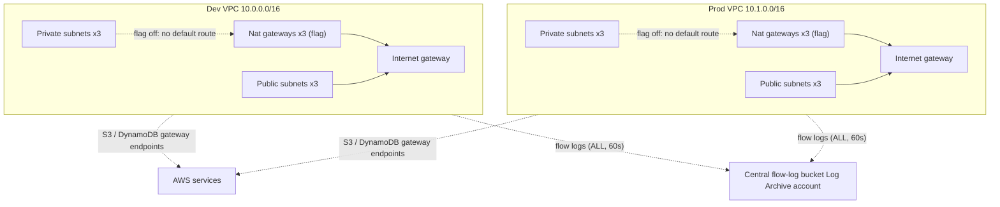

# ADR-0004: Per-Account VPCs with Flag-Controlled NAT Egress and Centralized Flow Logging

Date: 2026-11-18

Status: Accepted

## Context

The workload accounts (Dev and Prod) need network foundations before any workload lands: subnets across availability zones, a controlled path to the internet for private resources, private connectivity to AWS services, and network telemetry that a workload account cannot tamper with. The security and management accounts run no workloads and need no network footprint.

The network design must provide:

* An identical, reviewable network shape in every workload account, so Dev is a faithful rehearsal for Prod.
* A private tier that has no internet path by default, with egress as a deliberate, reversible enablement rather than a standing condition.
* Network logs that are delivered outside the accounts that generate them, so a compromised workload account cannot erase its own traffic history.
* No standing hourly charges for capabilities no workload is using yet.

## Decision

**Build one reusable VPC module and instantiate it once per workload account. Give private subnets no default route at rest; put NAT egress behind a per-environment flag that rests off. Deliver all flow logs to a single bucket in the Log Archive account.**

1. Scope and address layout
* VPCs exist only in the workload accounts. Dev is `10.0.0.0/16`, Prod is `10.1.0.0/16`; the management, Log Archive, and Audit accounts have no VPCs.
* Each VPC spans the three ca-central-1 availability zones in use (a,b,d), with one public and one private subnet per zone. Subnets are /24s derived from the VPC /16 by fixed offsets (public 0-2, private 10-12), so the layout is identical in every account and the per-account /16 sequence leaves room for future accounts without overlap.

2. One module, per-environment inputs
* `modules/vpc` is the single implementation. Each environment root supplies only its CIDR block, its NACL rule sets, and its NAT flag, so Dev and Prod cannot drift structurally; any fix or improvement lands in both at once.

3. Routing discipline
* The VPC main route table carries only the local route. A subnet with no explicit route-table association therefore fails closed instead of silently inheriting a path to the internet.
* Public route tables (one per zone) route `0.0.0.0/0` to the internet gateway. Private route tables receive a `0.0.0.0/0` route only while NAT is enabled for that environment.

4. NAT egress behind a flag, resting off
* NAT gateways (one for zone, with Elastic IPs) and the private default routes are created together under a single per-environment flag, with counts derived from the same condition and the zone list, never literals.
* The flag rests *false* in both environments. NAT gateways bill hourly and cannot be paused, so an always-on egress path would charge roughly $97 per month per environment for a capability no workload uses yet, and would keep a standing internet path the design does not want by default.
* Enabling egress for a real workload is a one-line, peer-reviewed change through the normal CI path.

5. Gateway endpoints before interface endpoints
* S3 and DynamoDB gateway endpoints are provisioned now: they are free, add no ENIs, and give both tiers a private path to storage and state-lock services regardless of the NAT flag's state.
* The endpoints are associated with **all** route tables, public and private, so the invariant "storage traffic never needs the internet path" holds uniformly instead of depending on which tier a resource lands in.
* Endpoint policies are deliberately left unset in this phase; scoping them belongs with the first workload (Phase 2.4), which is when there are real access patterns to scope to.
* Interface endpoints are deferred until a workload requires one; each costs per zone per hour and none is needed yet.

6. Default-deny inside the VPC
* The VPC default security group is emptied under module management (no ingress, no egress). An instance that does not explicitly choose a security group gets one that passes nothing, intead of the AWS default behavior. Workloads must use purpose-built security groups.
* Each tier gets a custom stateless NACL with explicit allows. The public tier additionally carries a low-numbered deny for RDP (3389) ahead of its ephemeral-range allow, so a known-bad port is refused even though the reply range is open. The default NACL is hardened under module management as well.

7. Centralized flow loggins
* Every VPC logs **all** traffic (accept and reject) at a 60-second aggregation interval to one bucket in the Log Archive account (`lz-flow-logs-<log-archive-account-id>`). The accounts generating the logs hold no rights over the bucket, its policy, or its lifecycle.
* The bucket policy is the canonical AWS log-delivery pair: the delivery service's ACL check is unfenced, and writes are fenced by `aws:SourceAccount` to the workload accounts only. The log destination is the bare bucket ARN; the delivery service composes the per-account path itself.
* Objects transition to Glacier at 90 days and expire at 365 days.
* The bucket uses SSE-S3 rather than a customer-managed KMS key. A CMK in the Log Archive account would require cross-account key grants for the delivery service and add a silent-failure mode to log delivery; this trade-off is accepted and revisited if a compliance requirement mandates CMKs.

8. Private-instance access: prototyped, not adopted
* An EC2 Instance Connect Endpoint was validated in Prod as a test rig (IAM-gated tunnel, `preserve_client_ip` disabled so the instance sees the endpoint ENI as the source, SG rules, no bastion, no public IP, and no dependence on NAT or the internet gateway) and was removed after the test.
* Adopting a standing private-access platform (Instance Connect Endpoint vs. Session Manager) is deferred to the first-workload phase, where the workload's operational needs decide it. Nothing standing was left behind in Prod.

## Architecture

Both VPCs are instances of the same module; only the CIDR, NACL rule sets, and NAT flag differ.

## Alternative considered

| Alternative | Reason not selected |
| ---- |---- |
| VPCs in every account, including security and management | Nothing runs in those accounts; an empty VPC is attack surface and cost with no workload to serve. |
| NAT gateways always on | Standing hourly cost (~97/month/environment) for an unused path, and a permanent internet route from private subnets that contradicts the default posture. |
| A single NAT gateway per environment | Cheaper, but makes every zone's private egress depend on one zone's gateway health. |
| NAT instances instead of managed gateways | Lower hourly cost, but self-managed patching and availability, and a throughput ceiling; not justified at this scale. |
| Flow logs to per-account buckets or CloudWatch Logs | Pe account buckets let a compromised workload account delete its own evidence; the landing zone's archive pattern is a central S3 bucket under separate account control. |
| Customer-managed KMS key on the flow-log bucket | Cross-account delivery grants and a silent log-delivery failure mode; SSE-S3 accepted with a recorded revisit trigger. |
| Interface endpoints for common services up front | Each endpoint bills per zone per hour with no workload to use it; deferred until a workload requires one. |
| Leave the default security group usable for convenience | Its AWS-default rules contradict the default-deny posture; the emptied default was also what provably stopped the public-to-private test connection. |

## Consequences

**Positive:** Identical network shape in Dev and Prod from one module; zero resting egress cost; egress enablement is a one-line reviewed change; network evidence is centralized outside the workload accounts' control and already carried the phase gate (delivered REJECT entries and a matched ACCEPT/REJECT pair across two ENIs); private tiers reach S3 and DynamoDB privately in every flag state.

**Trade-offs:** While NAT is off and no interface endpoints exist, private subnets cannot reach most AWS service APIs (accepted until the first workload in Phase 2.4); NACL rule sets are per-environment inputs and could diverge deliberately, with the module keeping the mechanism common; flow-log delivery to S3 is minutes-latent rather than real-time, so detection use cases belong to later phases' tooling, not this bucket.

## Verification and review

* Dev gate tests: home-to-public SSH accepted; RDP (3389) from the same source rejected at the NACL; public-to-private SSH rejected at the private instance's (emptied default) security group, with the matched ACCEPT/REJECT pair present in the delivered flow logs and a sample log file present in the central bucket. See the Phase 2.2 evidence checklist.
* Prod: structure verified equal to Dev; the NAT flag was proven functionally in both directions (an egress request from a private instance answered with a NAT gateway's Elastic IP while enabled; the same request failed after the flag was returned to off.)
* Revisit this ADR if a workload needs standing egress, interface endpoints are introduced, a compliance requirement mandates CMK-encrypted log storage, or a new account needs a CIDR allocation.

## References

* [AWS - VPC Flow Logs](https://docs.aws.amazon.com/vpc/latest/userguide/flow-logs.html)
* [AWS - NAT gateways](https://docs.aws.amazon.com/vpc/latest/userguide/vpc-nat-gateway.html)
* [AWS - Gateway endpoints](https://docs.aws.amazon.com/vpc/latest/privatelink/concepts.html)
* [AWS - Connect using EC2 Instance Connect Endpoint](https://docs.aws.amazon.com/AWSEC2/latest/UserGuide/connect-using-eice.html)
