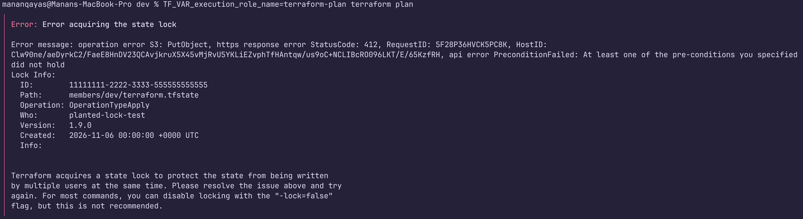
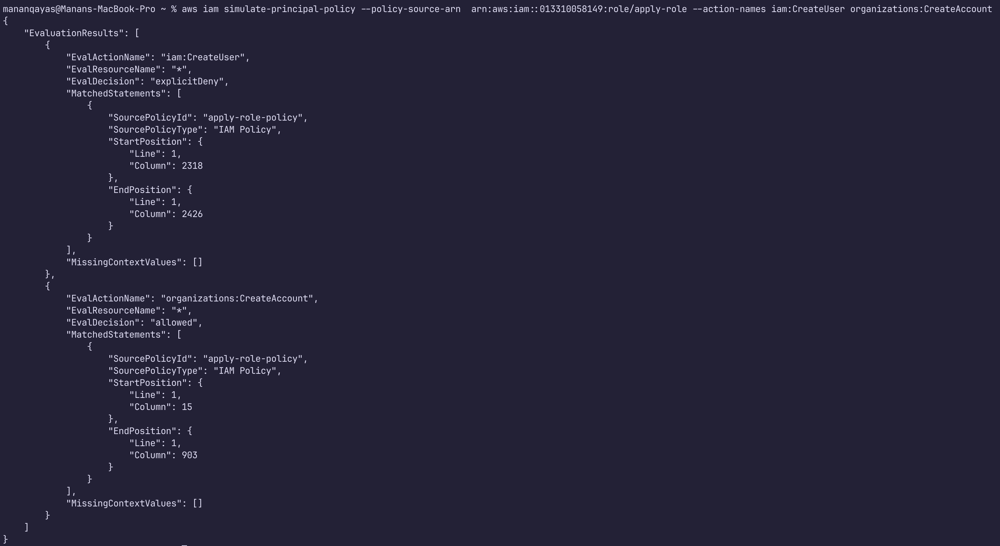
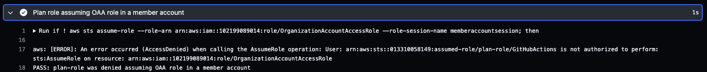
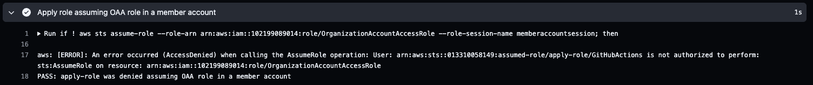

# Phase 2.0: Advanced GitOps Security: Multi-role Federation & Privilege Escalation Guardrails

The CI/CD engine splits execution into **two distinct workflows** with isolated IAM identities, completely decoupling the execution of `terraform plan` from `terraform apply`. This enforces a zero-trust model where a read-only process cannot modify state or infrastructure.

```
Feature Branch (Push) ──> 🛡️ Plan Workflow ──> Assumes Read-Only Roles (S3 State + AWS Orgs/Members)
                                │
Pull Request (Merge)  ──> 🛑 Prod Gate ─────> Requires Manual Approval & Env Guardrail
                                │
Main Branch (Approved) ──> 🚀 Apply Workflow ─> Assumes Management Apply Role 
                                                      │
                                                      └──> Cross-Account Assume (Member Member Roles)
                                                           [Enforced by Permissions Boundaries]

```
## What's implemented:

* [X] Built 3 Organizational Units (Security, Workloads, and Suspended), 4 accounts (Audit, Log Archive, Dev and Prod) using Terraform modular configurations automated provisioning via GitHub Actions

[Org Structure](./org-structure.txt)

[PR #30] (https://github.com/mananqayas/secure-aws-landing-zone/pull/30)

* [X] Provisioned AWS IAM Identity Center (SSO) for human access using short-lived credentials

* [X] Authored least privileged `terraform plan` and `terraform apply` roles inside management account using bootstrap terraform configurations via AWS CLI SSO access

All infrastructure after bootstrap is provisioned via CI (GitHub Actions + OIDC trust with AWS), local applies only as documented operator exceptions (state-import recovery, boundary targeted unlock, deploy-role -replace).

PRs for this setup (#30 to #45)

* [X] Implemented terraform state locking using latest implementation guidelines, adding `use_lockfile = true`



* [X] Permissions boundary policies are created for roles in management and member accounts following principle of least privilege to prevent privilege escalation



* [X] Every member account is baselined using a dedicated Terraform module named ( [account-baseline](../../../modules/account-baseline/) ) and graduate them once baselined

Subsequent plan and apply inside member accounts are done via member `terraform plan` and `terraform apply` roles.

PRS #44 and #45

* [X] No standing access for `OrganizationAccountAccessRole` inside member accounts for `plan` and `apply` CI roles in management account after graduation





* [X] Key decisions for Org Structure, Multi-account, and short-lived credentials are recorded in  [ADR-0001](../../adr/0001-delivery-and-identity-architecture.md) and [ADR-0002](../../adr/0002-organization-design.md)

## Compliance and Governance Control Mapping

| Implementation Practice | NIST CSF Mapping | SOC 2 TSC Mapping | Architectural Objective |
| ----------------------- | ---------------- | ----------------- | ----------------------- |
| **OIDC Federation** (Zero Static Keys) | **PR.AC-1** (Identity Management & Authentication) | **CC6.1** (Access Control / Identity Verification) | Eliminated credential exfiltration risk via short-lived, cryptographically verified tokens. |
| **Permissions Boundaries** (Least-Privilege Ceiling) | **PR.AC-4** (Access Enforcement / Least Privilege) | CC6.3 (Privilege Modification Enforcement) | Sets an immutable security ceiling that prevents automated deployment roles from escalating their own rights. |
| **Isolated Remote State** (Encrypted, Locked, Versioned S3) | **PR.DS-1** (Data-at-Rest Protection) | **CC6.1 / CC6.3** (Data Boundary Protection) | Guarantees state file integrity, prevents state corruption / concurrency issues, and blocks cross-tier decryption. |
| **Approval-Gated Applies** (Protected Main Branch & Env Gates) | **PR.IP-1** (Baseline Change Management) | **CC8.1** (Change Operational Execution Controls) | Ensures no mutations can occur in production without mandatory peer review and explicit structural sign-off. |
